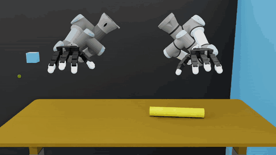
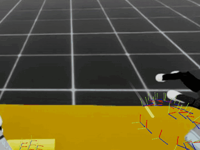
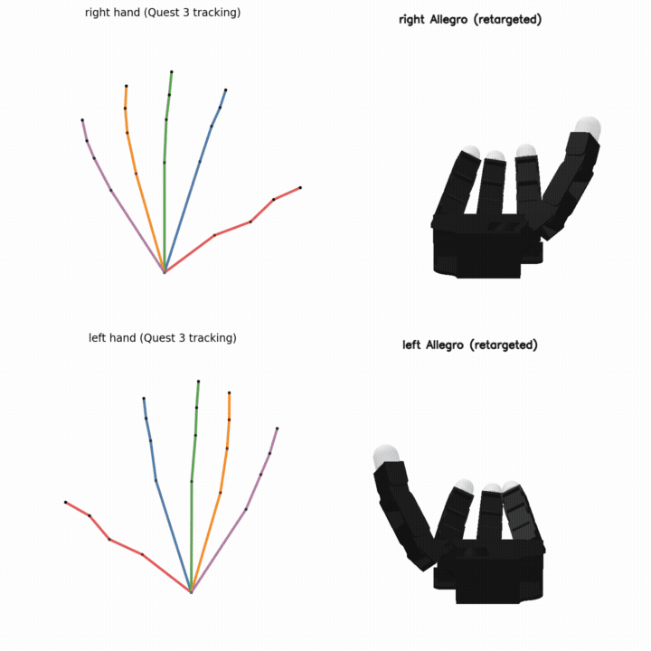
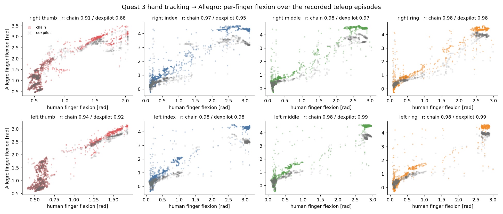

# quest3-dexterous-teleop

**Meta Quest 3 hand-tracking teleoperation of a dual-arm UR3 + Allegro hand cell in Isaac Lab,
with human→Allegro hand retargeting and a demonstration recorder.**

You put on the headset, see the simulated cell in stereo from the robot's head, and the two arms and
both 16-DoF Allegro hands follow your own arms and fingers. Each demonstration is saved as an episode
pickle (observations, the 44-D action, robot and object state, raw hand tracking) plus a front-view
video. A converter then turns the sessions into a fixed-length dataset for imitation learning.

| Recorded demo (front view, 2× speed) | Inside the headset |
|---|---|
|  |  |



*Quest 3 hand tracking (left) → retargeted Allegro joints (right), replayed from a recorded episode.*
Full-resolution videos: <https://ismael-esp.github.io/quest3-dexterous-teleop/>

---

## What is in here

```
Quest 3 ── hands (26 joints) + head ──►  CloudXR runtime  ──►  isaac_teleop/teleop_handover_cloudxr.py  (Isaac Lab 2.3)
        ◄── native stereo render  ─────  (isaacteleop)         │
                                                               ├─ wrists → clutched 1:1 mapping → differential IK → 6 arm joints / arm
  alternative path (any WebXR browser):                        ├─ fingers → AllegroDexPilot (chain retargeting) → 16 joints / hand
  Quest browser ⇄ quest_bridge/vuer_server.py ⇄ ZMQ ⇄          ├─ env.step(44-D action) on the dual-arm handover env (sim/)
  isaac_teleop/teleop_handover_vr.py (JPEG stereo)             └─ EpisodeRecorder → demos/<path>/<task>/<session>/ep_NNN_{ok|fail}.pickle + .mp4
                                                                                      │
                                                         scripts/convert_vr_demos.py ─┴─► Demo_success_<task>_<tag>.pickle (fixed T)
```

| Part | Files | What it does |
|---|---|---|
| **Hand retargeting** | `isaac_teleop/xr_hand.py`, `configs/allegro_hand_{left,right}_{chain,dexpilot}.yml`, `assets/allegro/` | Quest/OpenXR 25-joint hands → MediaPipe-21 keypoints → operator wrist frame → 16 Allegro joints per hand (details below) |
| **Arm control** | `isaac_teleop/arm_ik.py`, `isaac_teleop/frames.py` | Per-arm clutch (`SPACE`, `1`, `2`): anchors your wrist to the current end-effector, then follows 1:1 through differential IK with a lead clamp |
| **Native XR teleop** (main) | `isaac_teleop/teleop_handover_cloudxr.py`, `openxr_source.py`, `scripts/cloudxr_service.sh`, `scripts/run_cloudxr_teleop.sh` | Isaac Lab renders the scene natively into the headset through NVIDIA's CloudXR runtime; hand and head poses arrive through OpenXR |
| **WebXR teleop** (alternative) | `quest_bridge/`, `isaac_teleop/teleop_handover_vr.py`, `stereo_view.py`, `scripts/run_bridge.sh`, `scripts/run_teleop.sh` | No CloudXR: a vuer page in the Quest browser streams hands/head over WSS→ZMQ and shows JPEG stereo frames rendered by two Isaac cameras. Also has `--fake_vr` and `--replay` for headset-free runs |
| **Recording** | `isaac_teleop/recorder.py`, `snapshot.py`, `video_recorder.py` | Per-step record (schema 2, below), operator labels, front-view mp4 |
| **Dataset conversion** | `scripts/convert_vr_demos.py`, `sim/trl_utils/vr_demo_convert.py` | Cut at the env's success latch + tail, choose T = P95 of the cut lengths, hold-pad, write the BC dataset |
| **Simulation env** | `sim/` | The dual-arm UR3/UR3e + Allegro handover env (`handover_tshape`, `DirectRLEnv`), objects `rod`, `rod_slim`, `tumbler`; USD assets are a release download |
| **Evaluation / media** | `scripts/eval_hand_mapping.py`, `scripts/media/` | Flexion agreement between your hand and the Allegro on recorded episodes; the renders above |
| **Tests** | `tests/` | 81 unit tests (no Isaac) + 1 end-to-end Isaac test |

Recorded data: 6 teleoperated handover episodes (release `v1.0`, `vr_demos_handover_20260821.tar.gz`).

## Requirements

- Linux, NVIDIA RTX GPU (tested: Ubuntu 22.04, RTX 5070 Ti, driver 570).
- [Isaac Lab 2.3](https://isaac-sim.github.io/IsaacLab/) on Isaac Sim 5.1 / Python 3.11 in a conda env
  (tested: IsaacLab commit `7e2aba2`, env name `env_isaaclab`; set `ISAACLAB_ENV=<name>` if yours differs).
- Meta Quest 3 with hand tracking on (Settings → Movement tracking → Hand tracking), on the same LAN as the PC
  (a wired adapter on the PC helps).

## Install

```bash
git clone https://github.com/ismael-esp/quest3-dexterous-teleop.git && cd quest3-dexterous-teleop
conda activate env_isaaclab
pip install -r requirements-isaac.txt        # dex_retargeting 0.4.6 (+ pinocchio), pyzmq, msgpack, opencv, pytest
scripts/download_assets.sh                   # sim USD assets -> sim/assets/, sample demos -> demos/
scripts/setup_cloudxr_env.sh                 # CloudXR path: .venv_cloudxr with isaacteleop[cloudxr]==1.3.131
scripts/setup_bridge_env.sh [PC_IP]          # WebXR path only: .venv with the vuer fork + a TLS cert for PC_IP
```

Check it without a headset:
```bash
python -m pytest -q                                                       # 81 unit tests, ~3 s
GPU=0 DEVICE=cpu python -m pytest -m isaac -o addopts="" tests/test_isaac_integration.py -s   # fake-VR episode in Isaac
GPU=0 DEVICE=cpu scripts/run_teleop.sh --fake_vr --auto_engage --steps 600                    # same, by hand
```
`GPU=<n>` pins physics and the RTX renderer to that GPU (use it when another job occupies GPU 0).
`DEVICE=cpu` runs PhysX on the CPU, which is faster for a single env.

**Where the env comes from.** `isaac_teleop/paths.py` resolves the handover env in this order:
`$THESIS_WS` → a `thesis_ws/` folder next to this repo → the bundled `sim/`. A fresh clone uses `sim/`.

## Teleoperate and record (CloudXR, main path)

```bash
# Terminal 1 — CloudXR runtime + WSS proxy; leave it running all session.
scripts/cloudxr_service.sh            # first run: accept the NVIDIA CloudXR EULA
# Headset — Quest browser: https://nvidia.github.io/IsaacTeleop/client/release-1.3.x
#   enter the PC's IP -> open the "accept cert" link (https://<PC_IP>:48322/) -> back -> Connect.
#   Ports: UDP 47998, TCP 49100, TCP 48322.
# Terminal 2 — the teleop (headless; the scene is in the headset). ~60-90 s to start.
GPU=0 DEVICE=cpu scripts/run_cloudxr_teleop.sh --object rod --session_note "operator A, day 1"
```

| key (terminal 2) | action |
|---|---|
| `A` | reset the env and start a demo (episode + front-view mp4) |
| `F` | finish; the sim pauses for the verdict: `S` save **OK**, `N` save as **FAIL**, `D` discard |
| `SPACE` / `1` / `2` | engage/disengage both arms / left / right (clutch: disengage, move, re-engage) |
| `C` | re-center: your eyes go to the robot's head, facing the table |
| `K` | hold the view (then arrows glide, `O`/`L` up/down) |
| `3` | standalone video outside demos · `R` reset (discard) · `Q` quit |

The task: the left hand grasps the object, hands it over, and the right hand carries it to the goal marker.
**Before `F`, release, bring both hands back to the start pose and open them for ~2 s** — that is when the env
latches success (`SUCCESS` on the HUD). The full protocol (objects, counts, labels) is in
[`docs/cloudxr/DEMO_COLLECTION.md`](docs/cloudxr/DEMO_COLLECTION.md); recovery steps in
[`docs/cloudxr/RUNBOOK.md`](docs/cloudxr/RUNBOOK.md).

Useful flags (`--help` for all): `--object rod|rod_slim|tumbler`, `--hand_profile chain|dexpilot`,
`--finger_gain 1.15`, `--thumb_mode angle|ik`, `--robot_opacity 0.5` (see your own hands through the robot),
`--anchor_pos x y z` / `--anchor_yaw deg` (where your floor origin lands in the cell), `--max_episode_seconds 40`,
`--sim_steps_per_frame 2`, `--video_res 2560x1440`, `--require_success`.

## Teleoperate with the WebXR bridge (alternative)

```bash
scripts/run_bridge.sh                 # prints https://<PC_IP>:8012?ws=wss://<PC_IP>:8012
GPU=0 DEVICE=cpu scripts/run_teleop.sh --object rod
```
Open the URL in the Quest browser, accept the certificate, press the page's **Virtual Reality** button.
Your eyes are placed at the robot's head (`--eye_pos 0 0.05 1.65`, `--eye_yaw 90`) and your hands move 1:1
relative to it. Keys: `SPACE`/`1`/`2` clutch, `C` re-center, `A`/`F` + `S`/`D` demos, `R` reset, `Q` quit.
The view is two 640×480 JPEG streams (`--eye_res`, `--image_every`, `--jpeg_quality`), so it is lower-fidelity
than the CloudXR path; `--hfov` here must match the bridge's `--hfov`. Head pose comes from WebXR body tracking:
if the bridge prints `head none`, enable Body tracking in the Quest settings and reload.

## Hand retargeting

`isaac_teleop/xr_hand.py::AllegroDexPilot` maps one tracked hand to 16 Allegro joints, every control step:

1. **Keypoints.** OpenXR's 25 hand joints → MediaPipe-21 (drop the four finger metacarpals) → translate to the
   wrist and rotate into the operator wrist frame (palm-plane SVD frame + the MANO convention used by
   [dex_retargeting](https://github.com/dexsuite/dex-retargeting)).
2. **Fingers — `chain` profile (default).** A dex_retargeting `vector` optimizer matches 11 wrist→PIP, wrist→DIP
   and wrist→tip vectors (`scaling_factor 1.3`). The fingertip-only DexPilot objective (`--hand_profile dexpilot`)
   left the proximal joints unconstrained, so a real fist only closed 10–50 % there.
3. **Thumb — angle mapping.** The Allegro thumb is longer than a human's and its base points backwards, so IK
   kept the MCP joint half-flexed for every pose. Instead, opposition, palmar abduction, MCP and IP angles are
   measured on your thumb and mapped joint-to-joint (`thumb_angles_from_mp21`).
4. **Finger gain** 1.15 about the open limit (a fist reaches the joint limits).
5. **Pinch snap.** When your thumb tip comes within 5.5 cm of the index or middle tip, a small damped
   least-squares IK pulls the robot thumb tip onto that robot fingertip, fully at 2 cm, so precision pinches close.
6. **One-Euro filter** (strong smoothing at rest, little lag when moving), then reorder to the Isaac joint slots.

Both hands use the GeoRT/Isaac joint numbering (index `joint_0-3`, middle `4-7`, ring `8-11`, thumb `12-15`),
which is why the left config is our own: dex_retargeting's bundled left config targets the mirrored Wonik URDF
and swapped index↔ring (guarded by `tests/test_xr_hand.py::test_dexpilot_finger_identity`).

### How well it follows your fingers

`scripts/eval_hand_mapping.py` replays the tracked hands stored in the 6 recorded episodes (5 200 frames per hand,
the exact input the teleop retargeted) and compares finger flexion — the sum of the two bend angles along your
finger vs. the sum of the Allegro finger's three flexion joints:

| Pearson r | thumb | index | middle | ring | Allegro flexion range (index, P2–P98) |
|---|---|---|---|---|---|
| right, `chain` | 0.91 | 0.97 | 0.98 | 0.98 | 0.1 – 4.5 rad |
| left, `chain` | 0.94 | 0.98 | 0.98 | 0.98 | −0.2 – 4.4 rad |
| right, `dexpilot` | 0.88 | 0.95 | 0.97 | 0.98 | 0.1 – 3.7 rad |
| left, `dexpilot` | 0.92 | 0.98 | 0.99 | 0.99 | −0.1 – 3.5 rad |



Both profiles follow flexion monotonically; the difference is the range — with `chain` a closed human hand
drives the Allegro fingers to ~4.5 rad (full closure), with DexPilot they stop around 3.5–4 rad. The thumb is the
weakest finger on both hands. This measures agreement with the operator's hand, not grasp success.
The retargeter costs ~1.3 ms (`chain`) / ~1.7 ms (`dexpilot`) per hand per frame on the CPU. Reproduce:
`python scripts/eval_hand_mapping.py` (writes `docs/results/hand_mapping_flexion.{png,csv}`).

## Recorded data

`demos/vr_cloudxr/<task>/<session>/ep_NNN_{ok|fail|aborted}.pickle` (+ `.mp4`) and `session.json`
(CLI, git SHAs, object id and spec, `T_wrist3_palm`, retargeting configs and URDFs, dimensions, `schema_version`).
The WebXR path writes to `demos/vr/`. Per episode (variable length `T`, schema 2):

| key | shape | meaning |
|---|---|---|
| `observations`, `share_observations` | `(T,2,74)` | env observations per arm |
| `actions` | `(T,2,22)` | normalized `[-1,1]` action exactly as `env.step` consumed it (6 arm + 16 hand) |
| `raw_actions`, `joint_positions`, `joint_velocities` | `(T,2,22)` | rad / rad·s⁻¹ |
| `object_pos`, `object_quat` | `(T,3)`, `(T,4)` | object pose |
| `ee_pos/ee_quat`, `palm_pos/palm_quat`, `target_wrist_pos/quat` | `(T,2,3)/(T,2,4)` | wrist_3, palm (wrist_3 ∘ constant offset), IK target actually commanded |
| `fingertip_pos` | `(T,2,4,3)` | Allegro fingertips |
| `subgoal`, `success_env_step` | `(T,2)`, `(T,)` | task stage per arm, env success latch per step |
| `vr` | dict | `head (T,4,4)`, `left/right (T,25,4,4)` (NaN when untracked), `engaged` |
| `success_env`, `success_manual`, `metadata` | | env latch, operator label (`S`/`N`), `stage_peak`, `t_success_env` |

`agent0 = RIGHT arm, agent1 = LEFT arm.` Convert sessions into a fixed-length dataset:
```bash
python scripts/convert_vr_demos.py --tag vrA --sessions demos/vr_cloudxr/handover_tshape/2026*/ --dry_run
python scripts/convert_vr_demos.py --tag vrA --sessions demos/vr_cloudxr/handover_tshape/2026*/
# -> demos/converted/Demo_success_handover_tshape_vrA.pickle (+ Demo_Traj_...), prints the chosen T
```
The 6 sample episodes were recorded with the first recorder version (no labels, no success latch), so the
converter only accepts them with `--include_manual_fail`; 3 of the 6 physically reached the goal.

## Status and known limits

- **Tested here:** unit tests and the fake-VR Isaac test from a fresh clone with the bundled `sim/`; live
  teleoperation with a Quest 3 on both paths (August 2026, the episodes and videos above).
- **Not yet confirmed with a headset:** the most recent CloudXR fix (`--foveation none` and keeping the XR
  viewport alive when `ENABLE_CAMERAS` is set), written after a session where the headset stayed black.
  If that happens, see the black-headset row in `docs/cloudxr/RUNBOOK.md` and `configs/cloudxr_warped.env`.
- The loop runs at ~30 Hz with CPU physics (env step 18–25 ms + retargeting), i.e. the sim runs slower than real
  time; recorded demos are in 60 Hz sim time. Move deliberately and keep your hands within the UR3's ~0.5 m reach.
- The arms follow the hand pose with a lead clamp (`--clamp_pos 0.10` m ahead of the actual end-effector), so fast
  hand motions are tracked with some lag.
- Simulation only: nothing here commands real robots.

## Troubleshooting

| Symptom | Fix |
|---|---|
| `XR_ERROR_FORM_FACTOR_UNAVAILABLE (-35)` | no headset connected yet — press Connect in the CloudXR.js client; the app retries |
| Black headset while hands are tracked | the teleop prints `[xr] active viewport updates ...`; run with `--foveation none` (default). Last resort: `scripts/cloudxr_service.sh --cloudxr-env-config configs/cloudxr_warped.env` + `--foveation warped` |
| Renderer runs out of memory / lands on a busy GPU | `GPU=<free index> DEVICE=cpu scripts/run_cloudxr_teleop.sh ...` |
| Left-hand fingers swapped | you are using dex_retargeting's own left config; use `configs/allegro_hand_left_*.yml` |
| Bridge says `head none` | Quest: Settings → Movement tracking → Body tracking on, then reload the page |
| Port 8012 busy | `scripts/run_bridge.sh --port 8013` |
| Terminal left in raw mode after Ctrl-C | `stty sane` (the run scripts do it on exit) |
| Converter accepts no episodes | operators skipped the home-return tail (no success latch) — or pass `--include_manual_fail` |

## Layout

```
isaac_teleop/   teleop entry points, retargeting (xr_hand.py), arm IK, OpenXR source, recorder, paths.py
quest_bridge/   WebXR bridge: wire format, vuer event parsing, vuer server
configs/        retargeting configs (chain / dexpilot × left / right), CloudXR fallback env
assets/allegro/ Allegro URDFs + meshes (GeoRT numbering; the left hand is mirrored)
sim/            the handover env subset (task_registry, tasks/, trl_utils/, objects/); sim/assets via download
scripts/        setup, run, download, convert, eval, media
docs/           CloudXR runbook, demo protocol, media, results, project page
tests/          unit tests + opt-in Isaac test (-m isaac)
```

## Licenses and credits

- Code in this repository: BSD 3-Clause (see `LICENSE`).
- `assets/allegro/`: Allegro hand URDF and meshes as distributed with
  [GeoRT](https://github.com/facebookresearch/GeoRT) (CC BY-NC 4.0); the left hand is a mirrored version.
- Uses [dex_retargeting](https://github.com/dexsuite/dex-retargeting) (MIT),
  [NVIDIA Isaac Lab](https://github.com/isaac-sim/IsaacLab) / Isaac Sim, NVIDIA
  [IsaacTeleop](https://github.com/NVIDIA/IsaacTeleop) CloudXR runtime (NVIDIA CloudXR EULA, accepted on first run),
  and the [ROBOTIS fork of vuer](https://github.com/ROBOTIS-GIT/vuer) for the WebXR page.
- Related: [allegro-hand-retargeting](https://github.com/ismael-esp/allegro-hand-retargeting) (Manus glove →
  Allegro with GeoRT), [dual-arm-allegro-ros2](https://github.com/ismael-esp/dual-arm-allegro-ros2) (the real cell).
